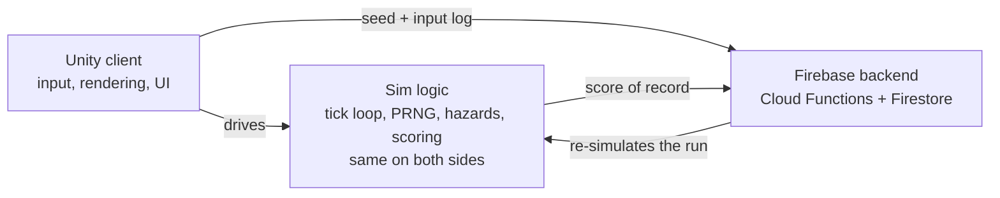
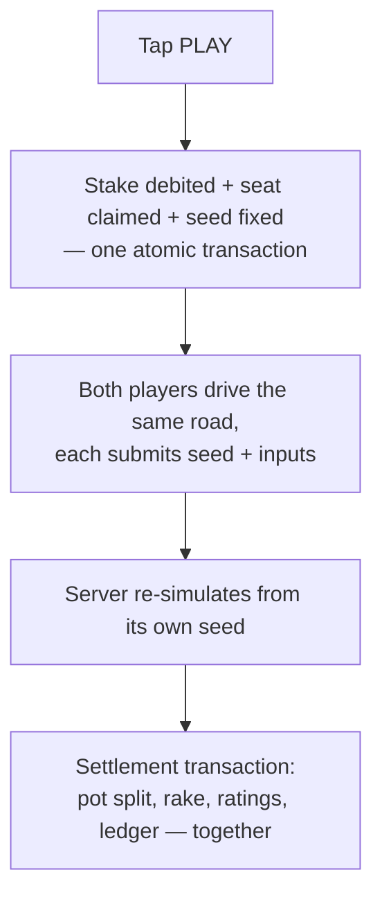
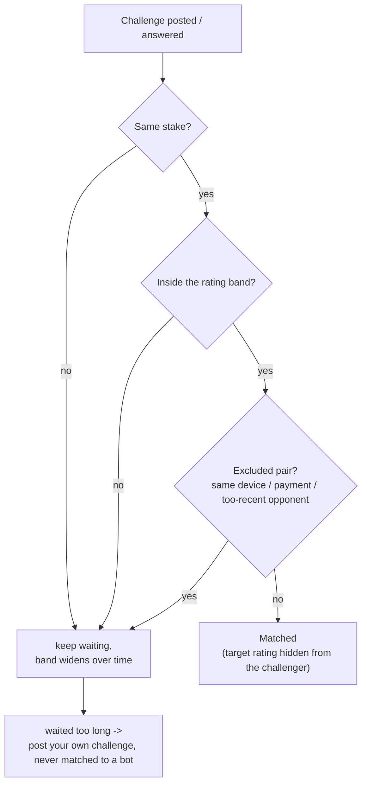

# REDLINE — submission overview

Async real-money 1v1 lane-runner. Two players stake the same amount and drive
the same seeded road. Score is distance times a lane multiplier. It is worth
nothing until you bank it in the cashout lane. One crash zeroes it. The
higher **banked** score takes the pot.

The whole game is one decision, over and over: stay in the 5× lane one more
beat, or cut across to safety now. The road, the money, and the matchmaking
all exist to make that decision matter and to stop anyone from gaming it.

I spent more of that time on Part B — rating, matchmaking,
the fairness proof — and on money correctness than on visual polish. The
brief calls out Part B as the part most candidates under-build, so that is
where I put the effort.

## Architecture

- The simulation logic — tick loop, PRNG, hazards, scoring — is the same on
  the client and the server.
- 34 recorded test vectors check both sides against each other, so they
  cannot quietly drift apart.
- The client never submits a score. It sends the seed and the input log.
  The server re-simulates the run, and that result is the score of record.
  A hand-edited score just gets logged next to the real, recomputed one.

## Money

- Money and rating move together, inside one database transaction, or not
  at all.
- Entry: stake debit, seat claim, and seed are fixed in one atomic
  transaction.
- Settlement: pot split, rake, ratings, and ledger update in another atomic
  transaction.
- Rollback is a compensating transaction. Fixing a bad settlement never
  means hand-editing a balance.
- Money is integer cents everywhere on the backend. A linter fails the
  build if a float literal shows up on a money path.

## Rating, matchmaking, fairness proof

- Rating is Elo-style. The K-factor starts high for new players and tapers
  as they settle in.
- Matchmaking pairs the same stake. It widens the acceptable rating gap
  the longer someone waits. It excludes pairs that look like collusion:
  same device, same payment method, matched too recently.
- The challenger never sees the target rating before playing. When it was
  visible, whoever saw it won about 78% of the time. Hidden, that is close
  to a coin flip.

I ran 2,000 simulated players through 50,000 matches, against the real
rating and matchmaking code, not a copy of it:

- Rating tracks skill. Correlation with true simulated skill climbs to
  about 0.70 after 50 matches, up from near zero at the start.
- Hiding the target works. The 78% edge drops to under 1 percentage point
  once the target is hidden.
- The economy holds steady. Rating distribution and rake stay stable
  across the run.
- I planted a sandbagger and a smurf on purpose. Neither was caught. The
  only collusion checks today are identity-based — same device, same
  payment method — and neither planted account shared anything with
  anyone.

## Infra: why Firebase, not Neon/Render

- I first tried Neon (Postgres) and Render for the API. I dropped both.
  Both are paid tiers, and self-hosting the database, API, auth, and
  scheduled jobs would have spent all the time on infrastructure instead
  of the graded work.
- Free-tier cold starts and rate limits also slowed down repeat testing.
- I moved to Firebase — Firestore, Cloud Functions, Remote Config,
  Anonymous Auth. Auth, hosting, and scheduled functions all worked out of
  the box, with no separate service to set up or pay for. That left more
  time for the simulation and money-correctness work.

## Where it stands

**Solid:** the shared sim logic and its 34 test vectors, the atomic
stake/settle/rollback path, the matchmaker and its collusion exclusions,
the fairness simulation above, and the full game loop tested end to end on
a real phone — sign-in, stake, drive, crash or bank, submit, settle.

## More detail

- [`README.md`](README.md) — build & run commands for the current (Firebase) stack
- [`SIMULATION-REPORT.md`](SIMULATION-REPORT.md) — the fairness proof in full
